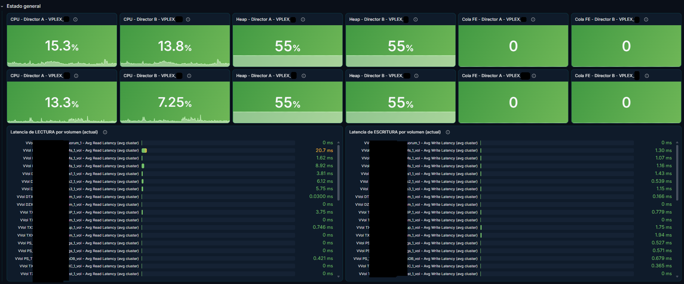
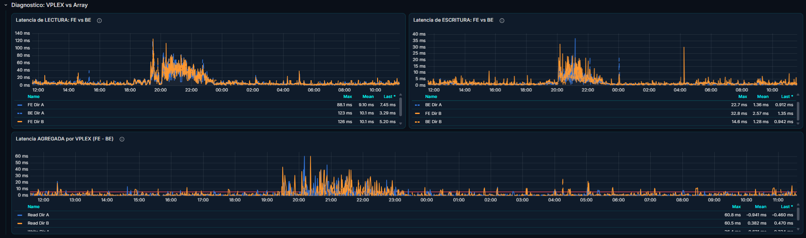
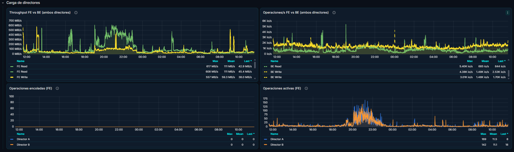
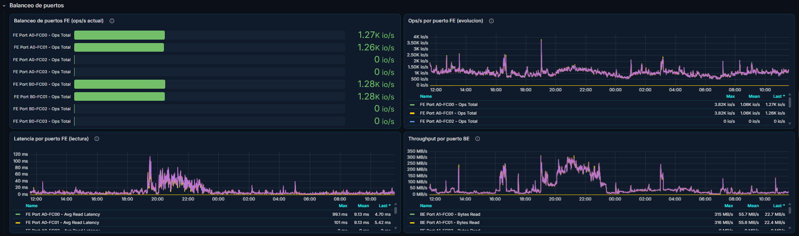
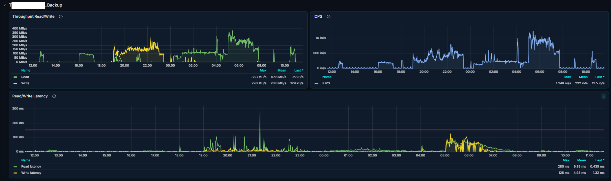
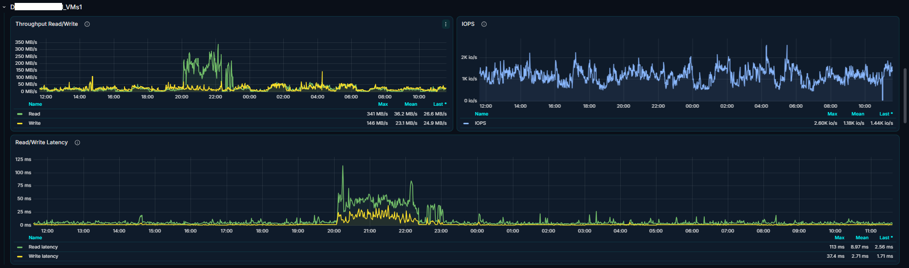
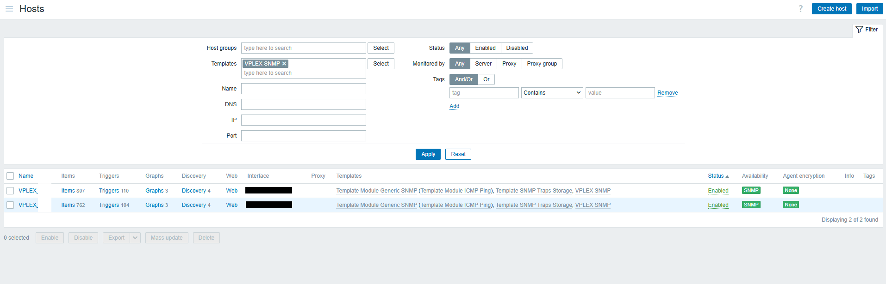
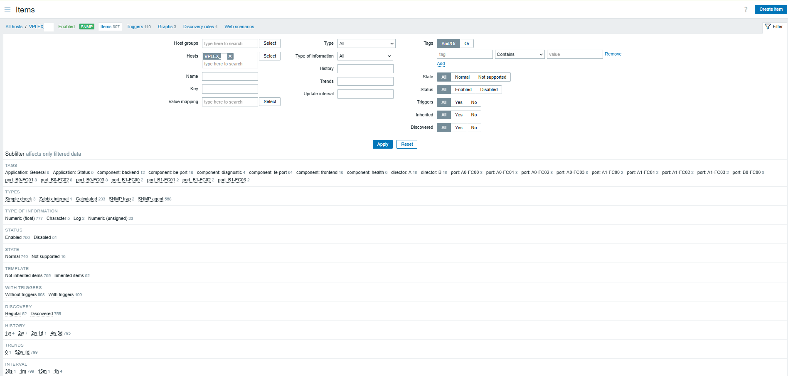
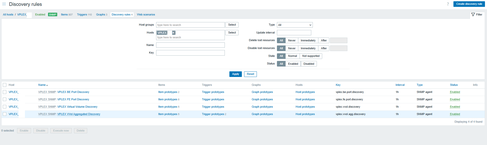
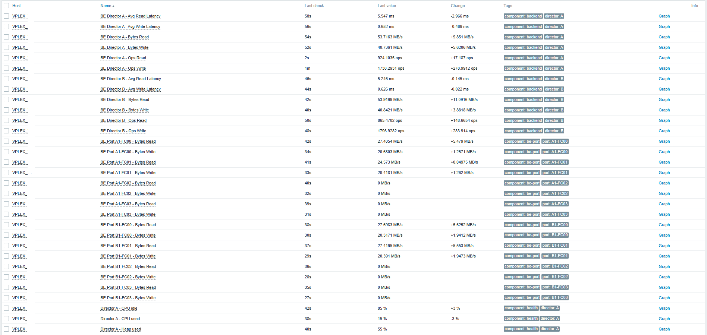

# Monitoreo de Dell EMC VPLEX Metro con Zabbix y Grafana

Template de Zabbix (SNMP) y dashboard de Grafana para **guardar el histórico** de las métricas que VPLEX muestra en tiempo real en su GUI nativa (Performance Dashboard): CPU, heap, throughput, IOPS, latencias y colas por director, puertos FE/BE y métricas por volumen virtual.

> **Importante:** este repositorio es un **punto de partida**. Todos los nombres (hosts, clusters, volúmenes, IPs) son **genéricos y de ejemplo**. Vas a tener que adaptarlos a tu entorno antes de que funcione. Las instrucciones están más abajo.

---

## Qué incluye

| Archivo | Contenido |
|---|---|
| `zabbix/template_vplex_snmp.yaml` | Template `VPLEX SNMP` para Zabbix 7.0: ítems, reglas de descubrimiento (LLD), triggers y macros |
| `grafana/dashboard_VPLEX.json` | Dashboard de Grafana con estado de directores, diagnóstico FE vs BE, carga, balanceo de puertos y una fila por volumen |

**No incluye** el archivo `VPLEX-MIB.mib` de Dell. Los OIDs que usa el template son los de la MIB (base `1.3.6.1.4.1.1139.21`) y se pueden consultar en tu propio equipo.

## Vista previa

> Las capturas son de un entorno real (VPLEX Metro, dos clusters). Los nombres de hosts, volúmenes e IPs fueron ocultados. Los valores y las formas de las curvas son reales y sirven de referencia de qué esperar.

### Dashboard de Grafana

**Estado general:** CPU, heap y cola FE por director de ambos clusters, y ranking de latencia por volumen.



**Diagnóstico VPLEX vs array:** latencia FE (línea sólida) contra BE (línea punteada) y la latencia que agrega VPLEX (FE − BE). La línea roja del último gráfico es el umbral de 5 ms del trigger.



**Carga de directores:** throughput y operaciones por segundo FE vs BE, operaciones encoladas y activas.



**Balanceo de puertos:** reparto de operaciones, latencia por puerto FE y throughput por puerto BE. Sirve para detectar multipath desbalanceado. Los puertos en 0 pueden no estar cableados o zoneados.



**Fila por volumen (ejemplo):** throughput, IOPS y latencia de lectura/escritura de un volumen. La línea roja marca el umbral de 150 ms del trigger. Todas las filas por volumen tienen esta misma estructura.





### Zabbix

**Hosts con el template vinculado** (uno por cluster):



**Reglas de descubrimiento** (las cuatro del template):



**Ítems del host.** La mayoría son ítems descubiertos por LLD (*Discovered*). El host de la captura también tiene otros templates vinculados (SNMP genérico, ICMP y traps), por lo que el total incluye ítems que no son de `VPLEX SNMP`. Si en tu entorno algún ítem queda en *Not supported*, revisá su OID con `snmpwalk`.



**Latest data** con valores reales de los ítems por director y por puerto:



---

## Requisitos

- **Zabbix 7.0** (probado con 7.0.28). 
- **Grafana** con el plugin de datasource de Zabbix (`alexanderzobnin-zabbix-datasource`). El JSON usa el formato de dashboard `dashboard.grafana.app/v2` y fue exportado desde Grafana 13.1.0. 
- Un VPLEX (el template fue armado y usado sobre un VPLEX Metro con dos clusters y dos directores por cluster) con el **agente SNMP accesible** desde el servidor o proxy de Zabbix.
- Acceso a la MIB `VPLEX-MIB.mib` para validar OIDs (en este entorno estaba en el Management Server, en `/opt/emc/VPlex/mibs/`).

---

## Cómo está armado

### Un host de Zabbix por cluster

Cada cluster VPLEX se monitorea como **un host de Zabbix** con interfaz SNMP y el template `VPLEX SNMP` vinculado. En el dashboard de ejemplo los hosts se llaman `VPLEX_CLUSTER1` y `VPLEX_CLUSTER2` y están en el grupo `Storage`.

### Macros (obligatorias)

La tabla de directores de la MIB está indexada por **IP del director**. Por eso el template necesita saber cuáles son:

| Macro | Valor en el repo | Qué hacer |
|---|---|---|
| `{$VPLEX.DIR.A.IP}` | `10.0.0.1` (placeholder) | Reemplazar por la IP del director A **tal como aparece en el índice SNMP** |
| `{$VPLEX.DIR.B.IP}` | `10.0.0.2` (placeholder) | Ídem para el director B |

**Sobrescribí las macros a nivel de host**, no en el template, porque cada cluster tiene IPs distintas.

Para ver qué IP aparece en el índice de tu equipo:

```bash
snmpwalk -v2c -c <community> <ip-o-host-snmp> 1.3.6.1.4.1.1139.21.2.2.4
```

Cada OID devuelto termina con la IP del director. Esa IP es el valor de la macro. (Si usás SNMPv3, ajustá las opciones del comando.)

### Qué monitorea el template

**Ítems por director (A y B):**
- CPU idle, CPU used (calculado: `100 - idle`) y heap.
- Front-end (FE): ops de lectura/escritura, bytes de lectura/escritura, latencia de lectura/escritura, ops activas y encoladas.
- Back-end (BE): ops, bytes y latencia de lectura/escritura.
- **Latencia agregada por VPLEX** (calculado): `FE - BE`, lectura y escritura, por director. Sirve para distinguir si la latencia viene del array o la agrega VPLEX.

**Descubrimiento automático (LLD):**

| Regla | Qué descubre |
|---|---|
| `VPLEX FE Port Discovery` | Puertos FE: bytes, ops, latencia, ops activas |
| `VPLEX BE Port Discovery` | Puertos BE: solo bytes (ver [Particularidades](#particularidades-de-vplex-y-de-su-mib)) |
| `VPLEX Virtual Volume Discovery` | Volúmenes virtuales, **uno por director**: IOPS, latencias, bytes |
| `VPLEX VVol Aggregated Discovery` | Volúmenes virtuales, **uno por volumen**: suma/promedio entre directores (ítems calculados) |

**Triggers incluidos:**

| Trigger | Condición | Severidad |
|---|---|---|
| Director no responde | Sin datos de CPU idle por 5 min | Disaster |
| CPU saturada | CPU usada > 85 % sostenido 15 min | High |
| Heap alto | Heap > 85 % sostenido 1 h | Warning |
| Cola en puertos FE | Ops encoladas > 0 sostenido 10 min | High |
| Latencia agregada por VPLEX | FE − BE > 5 ms sostenido 15 min (lectura y escritura) | Warning |
| Latencia alta por volumen | Latencia > 150 ms sostenida 10 min (lectura y escritura) | Average |

Los triggers usan `min()` sobre una ventana de tiempo para evitar falsos positivos por picos aislados. **Los umbrales son los de este entorno**: ajustalos según tu carga y tus SLAs.

> Los triggers solo generan eventos en Zabbix. Para recibir notificaciones (correo, MS Teams, etc.) tenés que configurar tus propios *media types*, *actions* y usuarios. No hay ninguna notificación ni webhook en este repo.

---

## Instalación

### 1. Template de Zabbix

1. `Data collection → Templates → Import`.
2. Seleccioná `zabbix/template_vplex_snmp.yaml` e importalo.
3. En el host de cada cluster VPLEX:
   - Agregá una **interfaz SNMP** apuntando al agente SNMP de VPLEX (versión y credenciales según tu configuración).
   - Vinculá el template `VPLEX SNMP`.
   - Sobrescribí las macros `{$VPLEX.DIR.A.IP}` y `{$VPLEX.DIR.B.IP}` con los valores reales.
4. Esperá a que corran las reglas de descubrimiento (intervalo de 1 h). Para no esperar: `Data collection → Hosts → <host> → Discovery → seleccionar la regla → Execute now`.
5. Verificá en `Monitoring → Latest data` que los ítems reciban valores y no estén en *Not supported*.

> Al reimportar el template sobre uno existente, revisá las opciones *Delete missing* para no borrar ítems por accidente.

### 2. Dashboard de Grafana

1. Instalá y habilitá el plugin de Zabbix para Grafana y creá un datasource que apunte a tu API de Zabbix.
2. Copiá el **UID** de ese datasource (`Connections → Data sources → tu datasource`; el UID está en la URL).
3. En `grafana/dashboard_VPLEX.json` reemplazá **todas** las apariciones de `DS_ZABBIX_UID` por tu UID. Con PowerShell:
   ```powershell
   (Get-Content .\grafana\dashboard_VPLEX.json -Raw -Encoding UTF8).Replace('DS_ZABBIX_UID','TU_UID_REAL') |
     Set-Content .\dashboard_VPLEX_local.json -Encoding UTF8
   ```
   O con `sed`:
   ```bash
   sed 's/DS_ZABBIX_UID/TU_UID_REAL/g' grafana/dashboard_VPLEX.json > dashboard_VPLEX_local.json
   ```
4. Importá el archivo resultante en Grafana (`Dashboards → New → Import`).
5. Si los hosts de Zabbix **no** se llaman `VPLEX_CLUSTER1` y `VPLEX_CLUSTER2`, reemplazá también esos nombres de la misma forma. Los filtros del dashboard (`host`, `group`, `item`) están escritos con nombres literales.
6. Si tu grupo de hosts no se llama `Storage`, hacé el mismo reemplazo en los filtros de grupo.

---

## Qué adaptar a tu entorno

Resumen de todo lo que es **de ejemplo** y tenés que cambiar:

| Elemento | Valor de ejemplo | Dónde |
|---|---|---|
| IPs de directores | `10.0.0.1`, `10.0.0.2` | Macros del template (sobrescribir por host) |
| Hosts de Zabbix | `VPLEX_CLUSTER1`, `VPLEX_CLUSTER2` | Dashboard |
| Grupo de hosts | `Storage` | Template y dashboard |
| UID del datasource | `DS_ZABBIX_UID` | Dashboard |
| Volúmenes | `VOL_01` … `VOL_39` | Dashboard (filas por volumen) |
| Umbrales de triggers | ver tabla de triggers | Template |
| Umbrales de colores en paneles | 70 / 85 % (CPU, heap), 20 / 50 / 150 ms (latencia) | Dashboard |

### Sobre las filas por volumen del dashboard

Las filas `VOL_01` a `VOL_39` son **ejemplos**: los nombres originales fueron reemplazados por nombres genéricos. En tu entorno esos volúmenes no existen, por lo que esos paneles aparecerán vacíos.

Opciones:
- **Borrar** esas filas y dejar solo las generales, que son reutilizables tal cual: *Estado general*, *Diagnóstico: VPLEX vs Array*, *Carga de directores* y *Balanceo de puertos*.
- **Regenerarlas** para tus volúmenes: duplicá una fila y cambiá el nombre del volumen en el filtro de ítem de cada panel (por ejemplo `/VVol <tu_volumen> - IOPS \(total cluster\)/`).

Los dos paneles de ranking de *Estado general* (latencia de lectura y escritura por volumen) usan una expresión regular (`/VVol .* - Avg Read Latency \(avg cluster\)/`), así que **sí** se adaptan solos a los volúmenes que descubra tu Zabbix.

---

## Particularidades de VPLEX y de su MIB

Cosas que se aprendieron durante el armado y que conviene saber antes de modificar el template:

1. **No confíes solo en la MIB.** La MIB marca como `not-accessible` columnas que el agente sí devuelve (por ejemplo, latencias FE) y marca como accesibles columnas que el agente no devuelve (por ejemplo, *queued*/*active* en BE). **Validá cada OID con `snmpwalk` contra tu equipo** antes de crear ítems nuevos. Puede variar según la versión de VPLEX.

2. **Los volúmenes aparecen una vez por director.** La tabla de volúmenes virtuales está indexada por `{IP del director, nombre del volumen}`. Un volumen expuesto por dos directores aparece dos veces, con contadores independientes. Por eso:
   - La regla `Virtual Volume Discovery` extrae la IP del director del índice SNMP con JavaScript (macro `{#DIRECTORIP}`) y las claves de los ítems incluyen volumen **y** director.
   - La regla `VVol Aggregated Discovery` deduplica los nombres y crea ítems calculados que suman o promedian entre directores (`... (total cluster)` / `... (avg cluster)`).

3. **Counter64 vs Gauge32.** Los contadores acumulativos (ops, bytes) usan *Change per second*; las latencias son valores instantáneos y **no** lo usan. Los pasos de preprocesamiento tienen *Custom on fail → Discard value* para que un reinicio de director o un wrap del contador no deje el ítem en *Not supported*.

4. **Unidades.** La MIB expone latencias en **microsegundos** (el template multiplica por `0.001` para mostrar ms) y bytes crudos (se multiplica por `1.0E-6` para mostrar MB/s). Las unidades llevan el prefijo `!` (`!ms`, `!MB/s`) para que Zabbix no les aplique prefijos SI y no muestre cosas como `KMB/s`.

5. **MB/s decimales vs MiB.** El template usa base 1000 (`×1.0E-6`); la GUI de VPLEX usa base 1024. Hay una diferencia de alrededor de 5 % entre ambas. Es intencional y no se corrigió para mantener continuidad del histórico. Si preferís coincidir con la GUI, cambiá el multiplicador a `9.5367431640625E-7`.

6. **Terminología invertida.** En VPLEX, "Throughput" significa operaciones por segundo (IOPS) y "Bandwidth" significa MB/s. El template y el dashboard usan los términos convencionales (IOPS y MB/s).

7. **Puertos BE.** El agente solo expone bytes en los puertos BE. No hay ops ni latencia por puerto BE. Tampoco hay cola/activas en BE a nivel de director.

8. **Cómo leer el diagnóstico FE vs BE.** La latencia FE es el tiempo completo que ve el host. La latencia BE es lo que tarda el array en responder al director. Si FE y BE suben juntas, el problema está en el array. Si FE sube y BE no, la latencia la está agregando VPLEX. Mirá también la cola FE: una cola sostenida distingue saturación real de latencia heredada del backend.

9. **Intervalos de actualización.** No uses *Custom intervals* flexibles que cubran las 24 h de todos los días: el intervalo base nunca llegaría a aplicarse.

10. **Dashboards: datasource por nombre de host y de ítem.** Si cambiás nombres de ítems en el template, los filtros del dashboard (que buscan por nombre de ítem, por ejemplo `/Director A - CPU used/`) dejan de encontrarlos. Mantené ambos sincronizados.

---

## Verificación rápida

1. `snmpwalk` contra el agente devuelve datos en los OIDs bajo `1.3.6.1.4.1.1139.21.2.2`.
2. En Zabbix, los ítems de directores muestran valores y no están en *Not supported*.
3. Los valores coinciden razonablemente con los de la GUI nativa de VPLEX para el mismo instante (esperá una diferencia de ~5 % en MB/s por la base 1000 vs 1024).
4. Tras ejecutar las reglas de descubrimiento, aparecen ítems `VVol <nombre> [dir <IP>] - ...` y los ítems `(total cluster)`.
5. El dashboard muestra datos en las filas generales.

---

## Trabajar con IA

Si vas a adaptar este proyecto a tu entorno con ayuda de una IA, el repositorio incluye el archivo [`AGENTS.md`](AGENTS.md) con el contexto del proyecto.

- **Chat web (Claude, ChatGPT, etc.):** pegá el contenido de `AGENTS.md` como primer mensaje y adjuntá este README, el template (`.yaml`) y el dashboard (`.json`). La IA solo conoce lo que le pasás en ese chat.
- **Herramientas que trabajan sobre carpetas (Claude Code, Cursor, etc.):** abrí el repositorio clonado. Algunas leen `AGENTS.md` (o `CLAUDE.md`) automáticamente; si la tuya no lo hace, pedile que lo lea al empezar.

Antes de compartir con una IA salidas de tu equipo (`snmpwalk`, exportaciones, capturas), reemplazá IPs, nombres de hosts y volúmenes por valores genéricos.

---

## Aviso

- Proyecto comunitario, **no afiliado ni respaldado por Dell Technologies**. Dell, EMC y VPLEX son marcas de sus respectivos titulares.
- **No se brinda soporte.** El proyecto se comparte tal cual, sin compromiso de respuesta ni de resolución de problemas.
- **Está abierto a sugerencias de cambios.** Si encontrás un error o tenés una mejora, abrí un *issue* o enviá un *pull request*.
- Se entrega **sin garantía**. Probalo primero en un entorno de prueba antes de usarlo en producción.
- Revisá siempre qué datos exponés al compartir capturas o exportaciones: nombres de hosts, volúmenes, IPs y UIDs pueden identificar tu infraestructura.

## Licencia

MIT. Ver el archivo [`LICENSE`](LICENSE).
